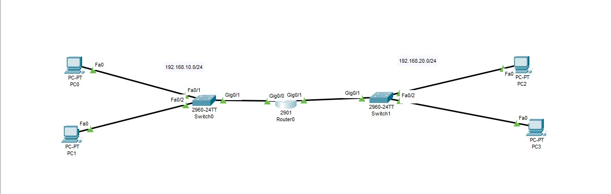
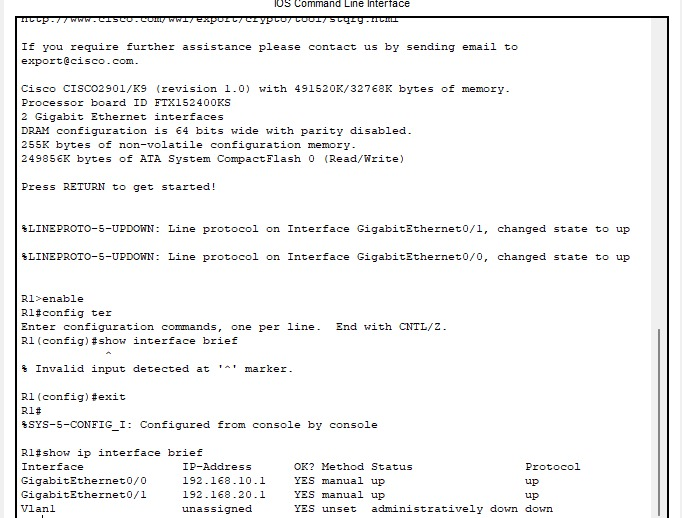
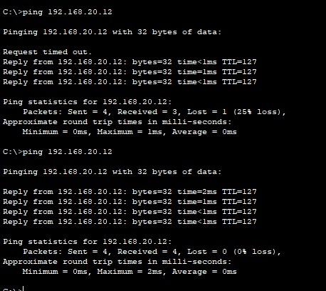

# Projet 1 : Réseau local avec 2 sous-réseaux et DHCP

## Objectif

Construire un réseau composé de deux sous-réseaux séparés, reliés par un routeur, avec attribution automatique des adresses IP par DHCP. Vérifier que les deux sous-réseaux communiquent entre eux.

**Outil :** Cisco Packet Tracer

## Schéma



## Plan d'adressage

| Réseau | Adresse réseau | Masque | Passerelle (routeur) | Équipements |
|--------|----------------|--------|----------------------|-------------|
| LAN 10 | 192.168.10.0/24 | 255.255.255.0 | 192.168.10.1 (g0/0) | SW0, PC0, PC1 |
| LAN 20 | 192.168.20.0/24 | 255.255.255.0 | 192.168.20.1 (g0/1) | SW1, PC2, PC3 |

Les adresses .1 à .10 de chaque réseau sont exclues du DHCP. Les PC reçoivent donc des adresses à partir de .11.

## Configuration du routeur

```
enable
configure terminal
hostname R1
interface g0/0
ip address 192.168.10.1 255.255.255.0
no shutdown
exit
interface g0/1
ip address 192.168.20.1 255.255.255.0
no shutdown
exit
ip dhcp excluded-address 192.168.10.1 192.168.10.10
ip dhcp excluded-address 192.168.20.1 192.168.20.10
ip dhcp pool LAN10
network 192.168.10.0 255.255.255.0
default-router 192.168.10.1
dns-server 8.8.8.8
exit
ip dhcp pool LAN20
network 192.168.20.0 255.255.255.0
default-router 192.168.20.1
dns-server 8.8.8.8
exit
end
write memory
```

## Tests et résultats

**Interfaces du routeur** (`show ip interface brief`) :



**Adresse reçue par DHCP sur un PC :**


**Ping de PC0 (LAN 10) vers PC3 (LAN 20) :**



## Ce que j'ai appris

- Créer deux sous-réseaux en configurant une interface du routeur dans chacun
- Le rôle de la passerelle : la sortie d'un réseau vers un autre
- Configurer un serveur DHCP sur un routeur (pools, adresses exclues)
- Le routeur fait communiquer deux réseaux différents
- Vérifier le fonctionnement avec `ping` et `show ip interface brief`

## Fichiers

- `reseau-local.pkt` : le projet Packet Tracer